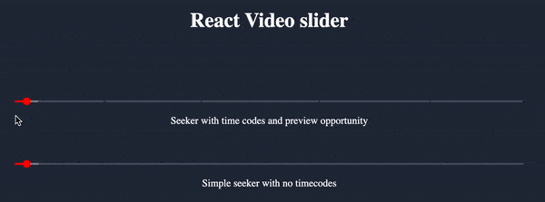

# react-video-seek-slider

The simplest, light weight and dependency free html video seeker like YouTube for React
With time codes and video preview opportunity

 [DEMO](https://egorovsa.github.io/react-video-seek-slider/)




## What's new in v9

- Seeking is built on Pointer Events with pointer capture: one code path for mouse, touch and pen, no global `window` listeners.
- `onChange` always calls the latest callback you pass (previously a stale one could be called until `max`, `offset` or the track width changed).
- The track width follows container resizes (`ResizeObserver`).
- The time code label is taken from the hovered position, so it is correct on touch devices as well.
- Seeking works correctly on horizontally scrolled pages.
- Dragging the slider no longer selects page text.
- Type declarations no longer include internal dev files.

## Breaking changes from v8 -> v9

#### `offset` is now in milliseconds everywhere

Before v9 the hover tooltip treated `offset` as seconds, while `onChange` added it to `offsetTime` as milliseconds. Now both use milliseconds, like every other time prop.

If you passed `offset` in seconds, multiply it by 1000:

```tsx
// v8
<VideoSeekSlider offset={10} ... />

// v9
<VideoSeekSlider offset={10000} ... />
```

#### `onChange` fires on press

`onChange` is now called as soon as the user presses the track, then on every move while dragging. In v8 a click without movement called it only on release. If you track seek events (analytics, network requests), expect calls on press.

#### Only the primary button seeks

Right and middle mouse buttons no longer move the thumb.

#### Pointer Events are required

The slider listens to `pointerdown` / `pointermove` / `pointerup` instead of `mouse*` / `touch*` events. All current browsers support them (Safari 13+). If your code stops propagation of pointer events above the slider, or relied on the slider's global `mousemove` / `mouseup` / `touchmove` listeners, review it.

#### Empty `timeCodes` renders a plain track

`timeCodes={[]}` used to render no track at all; now it renders the same track as without `timeCodes`.

## What's new in v8

- It's now built with Vite.js and is available for both React versions: 18+ and 19+.
- No migration needed.

## What's new in v6

- Added time codes and seeker preview fully like in youtube player!
- The codebase is completely refactored and optimized

## Braking changes from v5 -> v6

#### props names that are changed

- `progress` -> `bufferTime`
- `hideSeekTimes` -> `hideThumbTooltip`

## Braking changes from v4 -> v5

All time values you pass to props like `max`, `currentTime` and `progress` now are in milliseconds instead of seconds.

`onChange` prop will also return `time` param in milliseconds as well.

## How to install

```
npm i react-video-seek-slider
or
yarn add react-video-seek-slider
```

The package includes the CSS file, so you don't need to install any additional dependencies.

## How to import

For TypeScript usage there is a index.d.ts

```typescript
import { VideoSeekSlider } from 'react-video-seek-slider';
```

Also you have to import the CSS file:

```javascript
import "react-video-seek-slider/styles.css"
```

**Note:** The styles are automatically generated and included in the package.

## How to use

```tsx
//JSX
const [currentTime, setCurrentTime] = useState(0);
/// .....
<VideoSeekSlider
  max={1152000}
  currentTime={currentTime}
  bufferTime={400000}
  onChange={setCurrentTime}
  secondsPrefix="00:00:"
  minutesPrefix="00:"
  timeCodes={[
    {
      fromMs: 0,
      description: 'Description label of the first part',
    },
    {
      fromMs: 130000,
      description: 'Description label of the last part',
    },
  ]}
/>;
```

### Available component props

- `max` (number, required) - video duration (in milliseconds)
- `currentTime` (number, required) - current video progress (in milliseconds)
- `bufferTime` (number) - Current buffer progress (in milliseconds)
- `hideThumbTooltip` (boolean) - hide hover seek time (Default: false)
- `onChange` ((time:number, offsetTime:number)=>void, required) - script to be run when thumb change position
- `offset` (number, default:0) - offset in milliseconds, added to the displayed time and to `offsetTime` in `onChange`
- `minutesPrefix` (string, default: '') - when video duration is less than an hour you can use time prefix like "0:" so the time tooltip will show e.g "0:25:23"
- `secondsPrefix` (string, default: '') - when video duration is less than one minute it's possible to use time prefix like "0:00:" and the time tooltip will show e.g "0:00:10"
- `limitTimeTooltipBySides` (boolean, default: true) - limit the time tooltip position inside of the slider
- `timeCodes` (TimeCode[], default: undefined) - will divide slider into parts according to an array of times
- `getPreviewScreenUrl` ((hoverTimeValue: number) => string, default: undefined) - the callback function is going to be called each time when a slider in hovered. It will pass a current hover mouse time and expect and preview image url to be returned

### TimeCode object

- `fromMs` (number, required) - time stamp in milliseconds from where the part is starting
- `description` (string, required) - label that will appear on seeking tooltip

To use time codes you should provide to the component an array of timeCode objects according to scheme above.
The very first part is always should start from fromMs=0. The other parts any valuer according to those places where you would like to slice a slider.

## For development

just use:

```javascript
$ npm i
$ npm run dev
```

open your browser http://localhost:3000

## For Build

```
$ npm run build
```
